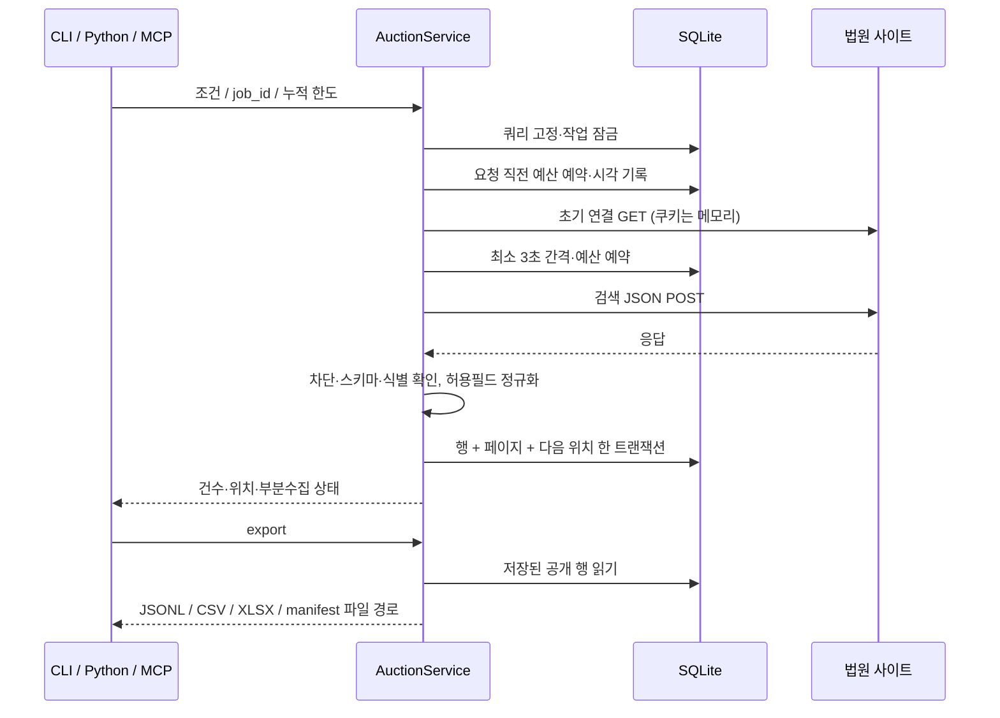

# 기술 흐름

CLI, Python, MCP는 `AuctionService`를 공유한다. MCP는 2025-11-25 tools·stdio만 구현하며 HTTP 서버·프롬프트·리소스·태스크 기능을 선언하지 않는다. [공식 수명주기](https://modelcontextprotocol.io/specification/2025-11-25/basic/lifecycle)와 [도구 명세](https://modelcontextprotocol.io/specification/2025-11-25/server/tools)를 기준으로 초기화→initialized 알림→목록·호출을 처리한다. 출력은 UTF-8 줄 단위 JSON-RPC뿐이다.

전송 잠금은 별도 SQLite 연결의 트랜잭션으로 유지한다. 프로세스 종료 시 OS가 잠금을 해제한다. 원본 요청 DB와 분리되어 요청 전 예산 커밋이 가능하다. 같은 작업의 동시 수집은 별도 작업 잠금으로 거부한다. 다른 DB는 서로 조정할 수 없으므로 사용자가 수집을 나누어 병렬 실행하지 않아야 한다.

대량 데이터는 DB와 파일로 제공한다. MCP 응답 1MiB, HTTP 본문 10MiB 제한을 둔다. 지역·세부 용도 하위 코드 동적 조회, 전국 전수 검증과 장시간 운영 보장은 포함하지 않는다.
